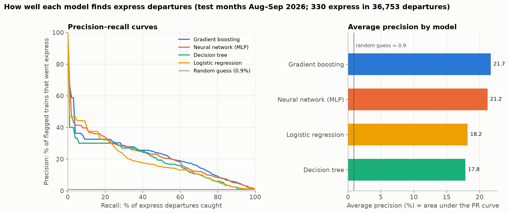
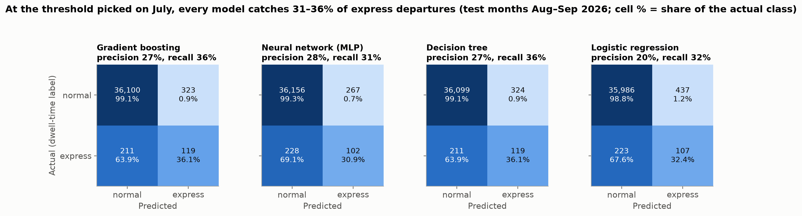
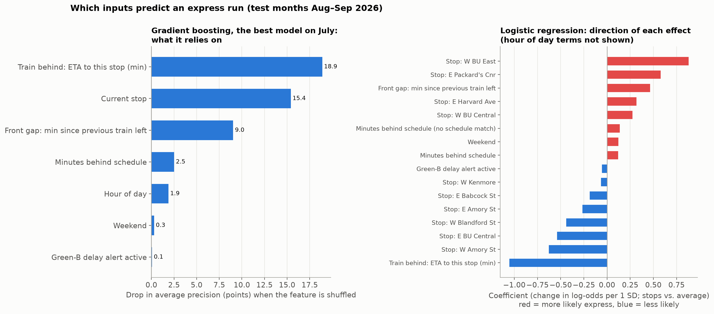
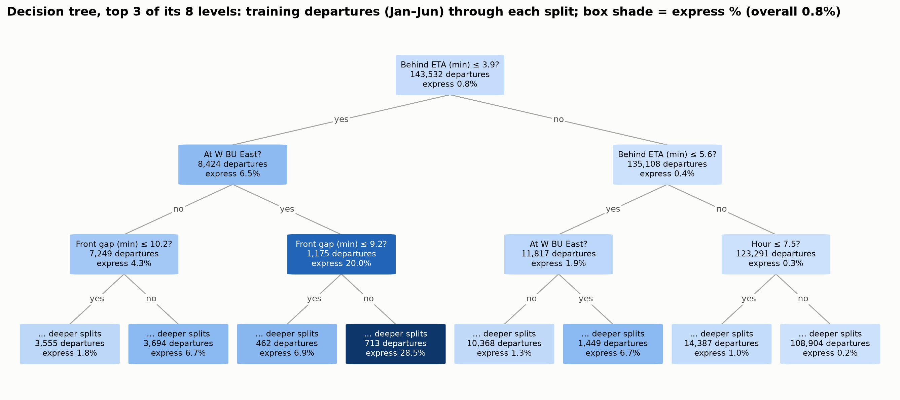
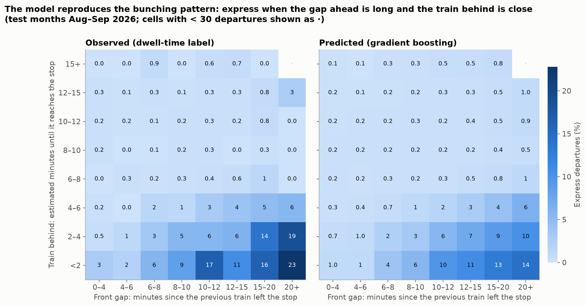

# November Check-in: Modeling and Results

**Project:** Predicting B Line express runs near BU (Kenmore ↔ Harvard Ave)
**Data:** MBTA headways + travel times (ArcGIS), MBTA LAMP Subway Performance Data and alerts, Jan–Sep 2026

Every number below comes from a script output: `data_processed/model_results.json`,
`data_processed/new_data_audit.json`, or a figure CSV in `data_processed/figure_data/`.

---

## 1. Problem setup

Each row of data = one train at one stop *s1* where it stopped, with at least 3 stops still ahead. We set this up so that we do not count the case when the train skipped one station because nobody is waiting there. That gives 206,431 rows of data, of which **1,696 went express (0.82%)**.

The problem: the moment the train *arrives* at s1, will it go express?

**Train / validation / test split by month, never shuffled:**

| Split | Months | Rows | Express |
|---|---|---|---|
| Train | Jan–Jun 2026 | 143,532 | 1,139 |
| Validation (tuning, threshold) | Jul 2026 | 26,146 | 227 |
| Test (scored once) | Aug–Sep 2026 | 36,753 | 330 |

We split by time, not at random, for two reasons. The real use is predicting *future* trains. And
trains on the same day share the same disruptions, so a random split would leak each day's
conditions into the test set.

However, i do realize that this has limitations that trains in Feb- May and Aug-Sept are busier than the rest months because of school. And maybe should have excluded the month of Jun- Aug for any purposes.

### Features

| Feature | Definition (at the moment the train arrives at s1) | Why |
|---|---|---|
| Train front gap | Minutes since the previous B train left s1. Set to 0 if it is still at the platform. | A long gap means a crowded platform and a late train, which is when dispatchers express. |
| Train behind ETA | Median Jan–Jun travel time from where the next B train last departed to s1, minus the time it has already spent| Express runs happen when trains bunch. The train behind can pick up the skipped riders. |
| Minutes behind schedule | Actual minus scheduled arrival at s1. *Signed* (late = +). | Expressing a late train is how dispatchers put it back on schedule. |
| Delay alert active | A B-branch DELAY alert is active | Disruptions cause bunching |
| Current stop, hour, weekend | — | Express runs only start at some stops (fig 6) and at some hours (fig 5) |


## 2. Models, and why each one

| Model | Input | Output | Hyperparameters (tried → chosen) | How to tune on validation (July) |
|---|---|---|---|---|
| **Logistic regression** | The 7 features. Missing values → training median + a was-missing flag.| P(express) for this train at this stop, 0–1. "Express" if P ≥ 0.063 | C (inverse strength of the L2 penalty) ∈ {0.01, 0.1, 1, 10} → **0.01** | Fit all 4 settings on Jan–Jun, keep the highest July average precision. Threshold = the one with the best July F1 |
| **Decision tree** | The 7 features as raw numbers (no scaling needed: a split only compares a value to a cut-off). Stop one-hot, hour as one number. Missing values handled by the tree. | P(express) = express share of the training trains in the leaf it lands in. "Express" if P ≥ 0.155 | max depth ∈ {3, 4, 5, 6, 8}, min trains per leaf ∈ {50, 200}, class weight ∈ {none, balanced} → **8, 50, none** | Same, over 20 settings |
| **Gradient boosting** (HistGradientBoosting) | Same as the decision tree | P(express) = sigmoid of the summed scores of all trees. "Express" if P ≥ 0.140 | learning rate ∈ {0.03, 0.1}, number of trees ∈ {200, 500}, max leaves per tree ∈ {15, 31} → **0.03, 200, 31**. Fixed: ≥ 100 trains per leaf, L2 penalty 1.0 | Same, over 8 settings |
| **Neural network** (MLP) | Same as logistic regression | P(express) from a sigmoid output unit. "Express" if P ≥ 0.205 | hidden layers ∈ {(32), (64, 32)}, L2 penalty α ∈ {1e-4, 1e-3, 1e-2} → **(64, 32), 1e-3**. Training stops when a held-out 10% of Jan–Jun stops improving | Same, over 6 settings |

**Why each model:**

- **Logistic regression:** simple and interpretable. Its coefficients give the direction of each
  effect (fig 10).
- **Decision tree:** rules you can read (fig 11).
- **Gradient boosting:** usually the strongest model on tabular data. Handles cut-offs,
  combinations of features and missing values natively.
- **Neural network:** learns non-linear combinations of features; course stretch goal.

**Not used:**

- **Linear regression:** the target is yes/no, so logistic regression is the right linear model.
- **TF-IDF and VADER:** there's no text attached to individual trains. The alert text describes
  whole-branch delays, and the plain "alert active" flag already tests whether alerts help (they
  don't; see §3).

**Metric: average precision** (area under the precision-recall curve). Only 0.9% of test
departures go express, so a model that always says "not express" is **99.1% accurate** and useless.
Average precision only rewards finding the rare express runs. Random guessing scores the base rate
(0.009). We also report ROC AUC, but it is flattered by the many easy "no" rows. The yes/no
threshold for precision, recall and F1 is the one that maximised F1 on July. It is never tuned on
the test months.

## 3. Results and interpretation (test months Aug–Sep 2026)

Every model was fit on Jan–Jun and tuned on July. The numbers below are from Aug–Sep, which no
model saw before: 330 express departures out of 36,753.

| Model | Avg. precision | ROC AUC | Precision | Recall | F1 |
|---|---|---|---|---|---|
| Gradient boosting (best on July) | **0.217** | 0.941 | 26.9% | 36.1% | 0.308 |
| Neural network (MLP) | 0.212 | 0.938 | 27.6% | 30.9% | 0.292 |
| Logistic regression | 0.182 | 0.892 | 19.7% | 32.4% | 0.245 |
| Decision tree | 0.178 | 0.880 | 26.9% | 36.1% | 0.308 |

### Fig 8: how well each model ranks the trains



**What it shows.** Each model gives every test train a score. Going down the list from the highest
score, the x-axis is the share of all express departures caught so far (recall). The y-axis is the
share of flagged trains that really went express (precision). The area under each curve is the
average precision (right panel). The flat line at 0.9% is random guessing.

**What we found:**

- **Gradient boosting (0.217) and the neural network (0.212) are the best**, about 24× better than
  random (0.009). Their curves overlap almost everywhere. We picked boosting because it had the
  higher July score (0.254 vs 0.249), but a 0.005 gap on test is too small to call either one
  better.
- **Logistic regression (0.182)** is the most precise of the four between 4% and 16% recall,
  but the least precise from 24% to 60%. The reason is that the effect of the train behind is a
  cut-off, not a straight line: express runs jump once it is within about 4 min (figs 11, 12). A
  linear model adds up straight-line effects, so it can't bend that sharply. It also can't
  represent "train behind close AND long gap ahead" as a combination.
- **The decision tree (0.178) is the worst on test, even though it beat logistic regression on
  July** (0.240 vs 0.206). A depth-8 tree has high variance: it fits the months it was tuned on
  well but carries over poorly. Its curve moves in flat steps because a tree gives one score per
  leaf. Boosting adds up 200 small trees. It keeps the tree's ability to find cut-offs and
  combinations and averages out the variance, which is why it is the best model.
- **Why no model scores higher:** an express run is a dispatcher's call. It depends on things that
  aren't in the data: the dispatcher's judgment, how crowded the train actually is (the B line
  reports no occupancy), and crew constraints. Our label is also a proxy (dwell < 25 s).

### Fig 9: the yes/no calls at a fixed threshold



**What it shows.** Each model's yes/no calls on the test months, using the threshold that maximised
F1 on July. Rows are what actually happened, and the cell % is the share of that row.

**What we found:**

- **Gradient boosting** flags 442 trains, and 119 of them went express. That is 27% precision
  against a 0.9% base rate, and 36% of all 330 express departures. Only 0.9% of normal trains are
  flagged by mistake (323).
- **The neural network** is more cautious: 369 flagged, 102 correct (28% precision, 31% recall).
- **The decision tree** makes almost the same calls as boosting at this threshold (119 correct,
  324 false alarms). Its lower average precision comes from the rest of its ranking (fig 8), not
  from this one threshold.
- **Logistic regression** catches a similar number (107) but needs 437 false alarms to do it. It
  has the lowest precision (20%).
- **Every model misses about two thirds of the express departures.** In fig 12, 193 of the 327
  express departures fall outside the "train behind close + long gap ahead" cells, where every
  model's score stays low.

### Fig 10: what the models rely on



**What it shows.** Left: how much gradient boosting's test average precision drops, in points,
when one feature is randomly shuffled. A big drop means the model relies on that feature. Right:
logistic regression's coefficient for each feature, per 1 SD. Red raises the odds of express and
blue lowers them. Each stop is compared with the average stop.

**What we found:**

- **Gradient boosting relies on three features:** train behind ETA (18.9 points), current stop
  (15.4) and front gap (9.0). Minutes behind schedule (2.5) and hour (1.9) add a little. Weekend
  (0.3) and the delay alert (0.1) add almost nothing.
- **Logistic regression agrees on the direction of each effect.** A closer train behind has the
  largest effect (−1.05: the odds fall as it gets further away). Next is a longer front gap
  (+0.46). Running late (+0.12) and weekend (+0.12) are small, and the delay alert is about zero
  (−0.06).
- **Where express runs start:** westbound BU East (+0.88), eastbound Packard's Corner (+0.58),
  eastbound Harvard Ave (+0.32) and westbound BU Central (+0.28). Westbound Amory (−0.63),
  eastbound BU Central (−0.54) and westbound Blandford (−0.44) almost never start one.
- **Both models learned the same story: an express run fixes bunching.** It happens when there is
  a long gap ahead and a train close behind, at a handful of stops.
- **Why the delay alert adds nothing:** an alert covers the whole branch for an hour or more. An
  express call reacts to one specific gap within minutes, and the gap features see that gap
  directly.

### Fig 11: the rule, as the decision tree writes it



**What it shows.** The top 3 of the tree's 8 levels. Each box gives how many training departures
(Jan–Jun) pass through it and what share of them went express.

**What we found:**

1. The first split is **train behind ≤ 3.9 min away**: 6.5% express if yes (8,424 departures),
   0.4% if no.
2. Among those, if the train is **westbound at BU East**: 20.0% express.
3. If **the previous train also left more than 9.2 min ago**: **28.5%** of 713 such departures
   went express, about 36× the overall 0.8%.

The tree picks the same three features as the other two models, in the same order: train behind,
stop, front gap.

### Fig 12: does the best model reproduce the pattern on months it never saw?



**What it shows.** Test departures grouped by the two gap features. Left: the share that actually
went express. Right: gradient boosting's average predicted probability for the same cells.

**What we found:**

- **Observed:** express runs pile up where the train behind is under 4 min away **and** the gap
  ahead is at least 10 min. These cells hold 1,194 test departures (3%) but 134 of the 327 express
  departures shown (41%). Where the train behind is 6+ min away, the rate stays under 3% in every
  cell.
- **Predicted:** boosting's rates follow the same two gradients. They rise as the train behind
  gets closer and as the gap ahead gets longer.
- **But the model is under-confident in the riskiest cells.** With the train behind under 2 min
  and a gap of 20+ min, 22.8% went express and the model says 14.4%. With the train behind
  2–4 min and a gap of 20+ min, it is 19.0% vs 10.2%. These cells are rare, and our settings
  (≥ 100 trains per leaf, L2 penalty) likely pull rare cases toward the average. This is the
  calibration work in §4.

**For a BU student:** if you're waiting at **BU East westbound**, the train pulling in has another
one right behind it, and you've been waiting 10+ minutes, there's roughly a 1-in-4 chance it goes
express. Westbound express trains usually skip Amory, Babcock and Packard's Corner, and often BU
Central (fig 6). If you're going to one of those stops, the next train is the safer bet.

### Validation vs. test

All four models score lower on Aug–Sep than on July (boosting: 0.254 → 0.217). Within the test
months, boosting scores 0.241 in August (157 express) and 0.203 in September (173 express). It
scores 0.240 westbound and 0.198 eastbound. Each month has only ~150–230 express runs, so these
numbers are noisy. September is also the first month with students back, and dispatch may differ
then. We will test this on Oct–Nov 2026 (see §4).

### What each group of features adds (gradient boosting settings, average precision)

| Features | Validation (Jul) | Test (Aug–Sep) |
|---|---|---|
| README features only (front gap, behind ETA, minutes behind schedule) | 0.104 | 0.103 |
| + current stop and hour | 0.250 | 0.221 |
| All features **except** minutes behind schedule | 0.255 | 0.212 |
| All features **except** the delay alert | 0.255 | 0.222 |
| **All features (final)** | **0.254** | **0.217** |
| All features + dwell at s1 (not used: only known when the train leaves) | 0.423 | 0.319 |

- **The three README features alone are 11× better than random** (0.103 vs 0.009). Adding where
  and when the train is more than doubles the score.
- **After that, the rest barely matter.** Minutes behind schedule, the delay alert and weekend
  together change the score by less than 0.01 (July +0.004, test −0.004). That is within noise
  at 200–300 express runs per split. Lateness matters on its own (fig 10), but a late train is
  late *because* the gap ahead of it is long, and the front gap already captures that.

## 4. Limitations and next steps (December)

- **Label:**
  - It is a proxy, and this can't be fixed with current data. The MBTA hopes to start logging
    express calls next year.
  - We also haven't yet tested how sensitive results are to the 25 s and 3-stop cut-offs.
- **Out-of-time check:** LAMP_ALL_RT_fields has Oct–Nov 2026. Scoring the final model there would
  show whether the September drop is a seasonal effect or noise.
- **Calibration:** turn the score into a probability a rider could trust (e.g. "1 in 4"). Fig 12
  suggests the model is slightly under-confident in the riskiest cells.
- **Engineering:** Makefile, tests, a GitHub workflow, the final README, and the recorded
  presentation.

## 5. How to reproduce

```bash
cd src
../.venv/bin/python extract.py            # raw ArcGIS CSVs → B line parquet (October)
../.venv/bin/python process.py            # dwell-time express label (October)
../.venv/bin/python visualize.py          # figs 1–7 (October)
../.venv/bin/python download_schedule.py  # LAMP Subway Performance Data, Jan–Sep 2026 → schedule
../.venv/bin/python features.py           # model table: arrival-time features + split
../.venv/bin/python model.py              # 4 models, tuning on July, test scores (~1 min)
../.venv/bin/python visualize_model.py    # figs 8–12
../.venv/bin/python audit_new_data.py     # LAMP file audit → data_processed/new_data_audit.json
```

`audit_new_data.py` and `features.py` also need the two LAMP Tableau exports in `datasets/lamp/`:
`LAMP_RT_ALERTS.parquet` and `LAMP_ALL_RT_fields.parquet`.
